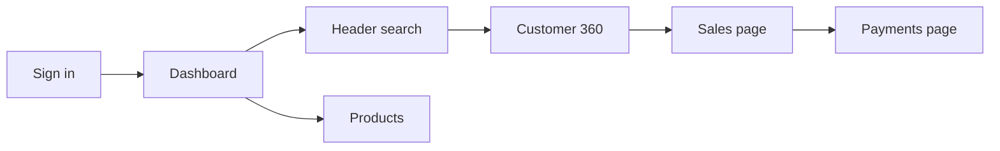

# UI/UX audit — module flows

Reviewed the screens that actually mount from `app/src/App.tsx`, against the daily jobs in `docs/MODULES.md`. Tables, undo, labels, and header search were already in place. Items 1–6 in the build order at the bottom are now in those screens. Side drawers stay a later pass, as already noted in `docs/MODULES.md`.

## How a day actually goes

On a phone, the bottom bar can start a sale, a payment, or a customer. On a desktop wider than 980px that bar is hidden (`app/src/index.css`), so the same jobs start only after opening the page and finding its own button. Header search finds a product, a shop, or an invoice, then drops you on a list. It does not start the next action.

## Already clear enough

- Sign-in copy, field labels, and the notices panel versus the account menu.
- Product, sale, and purchase lists are tables with preview, edit, archive, and undo.
- A shop page has Call, WhatsApp, statement, bought / paid / owed, and a status dropdown.
- Profit, cost, and partner balances stay off screens the role cannot see.
- Forms stay in the current popup. Do not add a drawer in this pass.

## Fix first — the path is hard to see

- **Desktop has no New.** Put a New menu in the top bar: Sale, Payment, Customer, Product, Purchase, Expense, Follow-up. Each item opens that page with the form already open. Keep the phone bottom bar.
- **Search ends too early.** Label each hit as Shop, Product, or Invoice. A shop hit should offer Open and New sale for that shop. An invoice hit should open that invoice. Today an invoice search goes to `/sales` with no invoice selected, and New sale on a shop is a plain link to `/sales` that does not keep the shop (`app/src/crm/CrmScreens.tsx`).
- **Notices and dashboard cards are dead ends.** “Customers owe”, stock LOW/OUT, and each notice should open the matching shop, product, or invoice. Cards in `Dashboard` are not links.
- **Move wipe-the-books off the home screen.** Load sample, import workbook, and restore backup sit under the morning numbers and can replace the whole business. Move that block to Settings. Leave Download backup where it is, or move it with them.
- **The chart plots two different units on one axis.** Sales in euros and margin percent share the same scale, so a 71% margin looks like €71. Keep euros on the bars. Show margin as its own figure, or on a second axis labelled percent.

## Module by module

**Dashboard.** The period selector and the two groups of figures (this period / right now) are understandable. The partner panel says the same numbers twice: a sentence list and a table. Keep the table. Stock is every product as `C1: 0 pcs OUT`. Show LOW and OUT first, with a link to Products. Empty period copy is only “No sales in this period”, with no button to record a sale.

**Products.** The table and the new-product popup are usable. Category, colour, and model are free-text boxes, so “Cases” and “Phone Cases” become different categories. Those should be choices edited in Settings. The price box does not say the amount is in euros.

**Customers and suppliers.** Still one joined sentence per row, plus a separate “Open shop” link. Use a table: shop, phone, city, owed, last order. The row itself opens the shop. The new-customer form has shop, phone, NIF, and credit limit only, so the shop page subtitle often falls back to the word “lead”, and city, email, and address cannot be entered. Credit limit is typed as euros with no unit label.

**Customer 360.** The header actions and the five figures work. Sales and payment tabs are undated one-line lists with no link to the invoice or a Record payment button. There is no Notes tab and no empty hint when a tab has nothing.

**Pipeline.** Columns and drag-to-move work, and a shop with no status lands in Lead. Cards show name and city only. Add phone and the next follow-up. An empty column that says “Drag a shop here” is fine once there is at least one shop; with no shops, say how to add one.

**Follow-ups.** Today / Overdue / Upcoming / Done is the right split. There is no New button on this page, and an empty tab is a blank list. Add New follow-up, and a line such as “Nothing due today”.

**Calendar.** Year view draws every day of twelve months, with event links inside the cells. That page is too dense to scan. Open on Month. Year can be twelve month counts that open the month.

**Purchases.** Same shape as sales, which is good. Shipping is a bare number. Say it is euros and that it is spread across the lines. Received versus ordered needs a short status word on the row (open / part received / received), not only quantities in the form.

**Payments.** Customer payments and supplier payments share one page and one New button, then a kind switch inside the popup. Split them with two tabs, Customer and Supplier, each with its own New button. The method is not chosen (customer payments are stored as Cash, supplier payments as Transfer). Show method as a choice, and say which invoices the customer payment will clear.

**Expenses and transfers.** The page introductions are clear (“shop costs come off the profit”, “does not change the profit”). Category, currency, and partner are free text or easy to mix up. Use the partner list and a category list. Amount fields should say euros.

**Reports.** The view switch and export are clear. From / To have no “This month” shortcut, so the dashboard period and the report period feel like two different tools. Ageing and profit tables are fine. Empty reports should say the range has no sales.

**Activity.** A search box over a raw sentence. Show who, what, which record, and when, in a table. Keep it read-only.

**Settings.** Still the invoice footer only (`app/src/admin/SettingsScreen.tsx`). This is where categories, colours, payment methods, and overdue days have to live before the other forms can offer choices instead of typed text.

**Users.** Name, email, and role are labelled, and the list shows the role. Deactivate versus purge is explained. No change needed for this pass.

## Money

`app/src/shared/money.ts` prints `€ 1.234,56` (space after the euro sign, dot for thousands, comma for cents). The chart tooltip uses the same formatter. Negative amounts print as `-€ 130,00`.

## Order to build later

1. Desktop New menu, search actions, and shop-to-sale keeping the shop.
2. Dashboard cards and notices that open the right record; chart scale; move sample/import/restore to Settings.
3. Customer and supplier tables; customer fields that match the shop page; follow-up New and empty tabs.
4. Payment tabs and a visible method; calendar defaults to Month.
5. Settings lists, then dropdowns on product, expense, and payment forms.
6. Portuguese money format.
7. Side drawers, still later.
